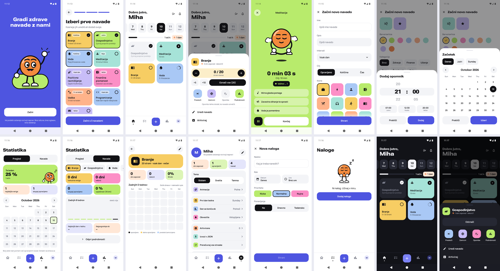
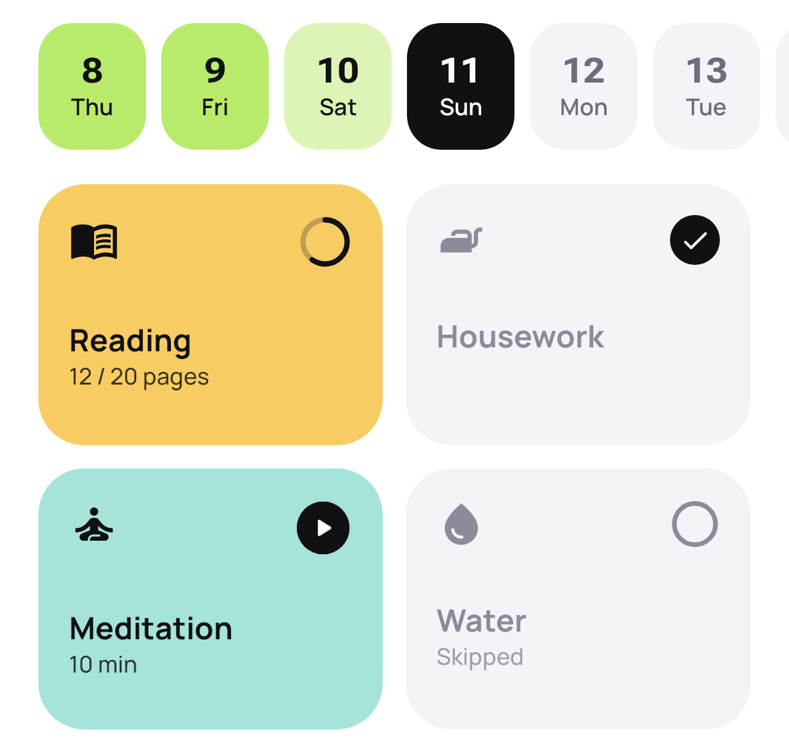
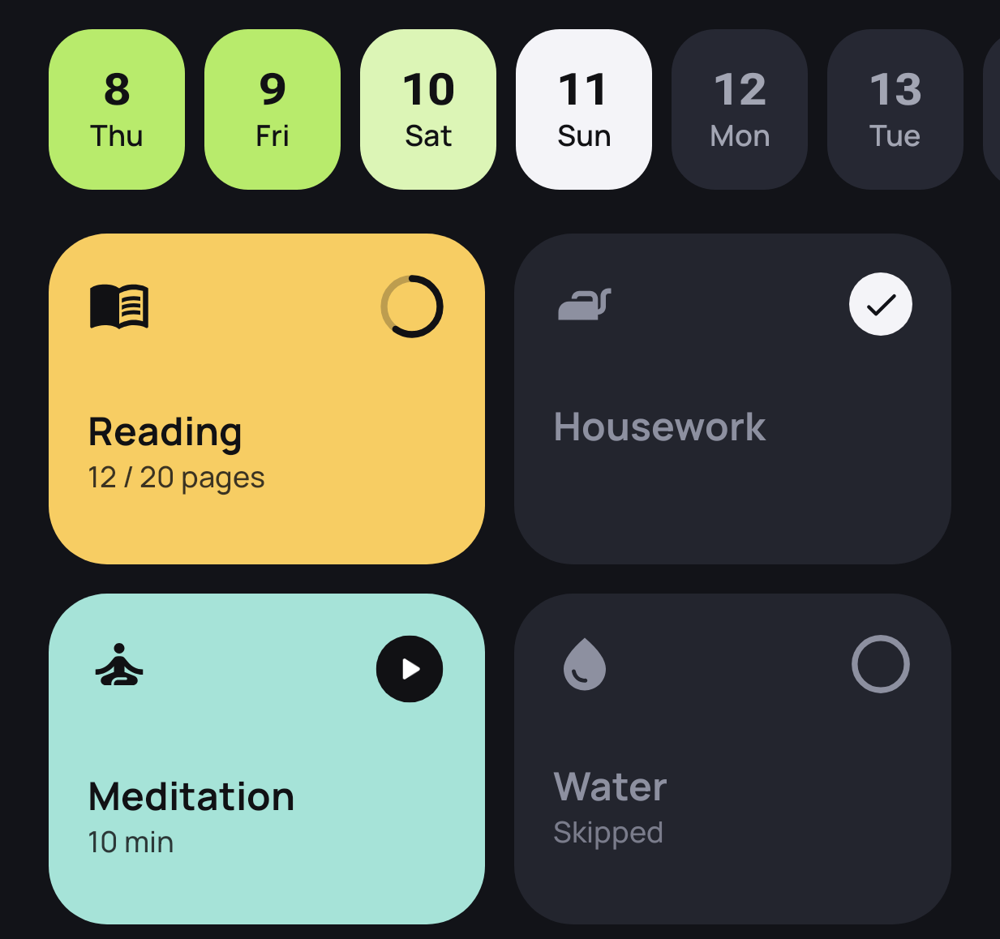
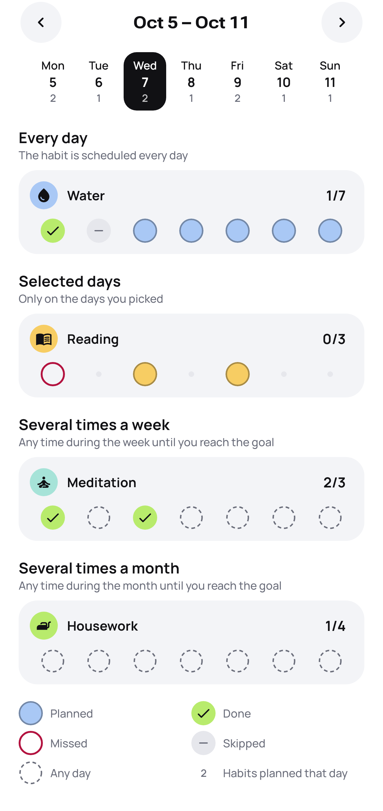
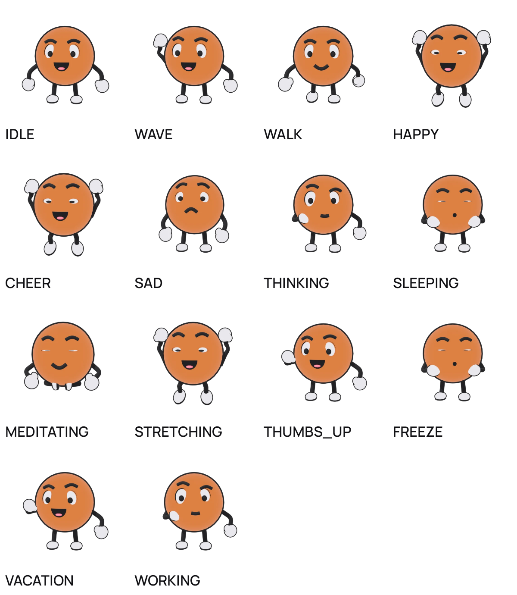

# Streak — offline habit tracker

**A privacy-first habit tracker for Android that works entirely offline.**
No account, no server, no ads, no analytics: everything you log stays on your phone, in an encrypted database.


-3DDC84?logo=android&logoColor=white)




<p align="center">
  
  &nbsp;
  
  &nbsp;
  
</p>

---

## Why Streak

- **Private by design.** The app has no `INTERNET` permission. The database is encrypted with SQLCipher, with a key held in the Android Keystore.
- **Flexible habits.** Yes/no, quantity (8 glasses, 20 pages) or timed sessions, scheduled every day, on chosen weekdays, or *X times per week/month*.
- **Streaks that are fair.** Skips, freezes and vacations don't break a chain. "Day ends at" (e.g. 04:00) lets night owls log after midnight.
- **Delightful, not noisy.** A 3D mascot celebrates milestones, and reminders go quiet once you're done for the day.

## Features

| | |
|---|---|
| **Home** | Time-of-day greeting, a week strip for logging past days, and pastel habit cards. Tap to complete or add +1; long-press to skip, freeze, add a note, edit or archive. |
| **Habits** | Goals can be yes/no, a quantity with a unit, a duration, or a habit to quit (counts days without a slip; slips are logged on purpose, never by an accidental tap). Schedules: daily, chosen weekdays, or X times per week/month. Each habit can have a category, part of day, several reminders, and start/end dates. |
| **Sessions** | Timed sessions that keep running in the background, with a stopwatch notification (Pause/Finish), a goal alert, on-device generated ambient sounds (brown noise, rain, waves, fire) and session history. Launcher shortcuts start a session or a new habit. |
| **Statistics** | Three tabs. **Overview:** weekly summary and a month calendar with backfill. **Habits:** current/best streak, completion rate, best weekday, last 8 weeks, heatmap. **Plan:** a week grid of what's scheduled, done or missed. |
| **Reminders** | Only fire if the habit isn't done yet, with *Done* and *Snooze 15 min* actions. There is a morning brief and an evening nudge, plus quiet hours and a daily cap. Habit names are never shown on the lock screen. Alarms survive reboots, updates and time-zone changes. |
| **Mood** | A daily mood (1–5) with optional energy and a note, logged from a Home card, the + menu or an evening notification. The Mood tab in Statistics shows a calendar, the average and how mood relates to completed habits. |
| **Review** | A month or year in review: habits done, perfect days, the longest run, the most consistent habit, best weekday, focus time and mood, shareable as an image without habit names. |
| **Achievements** | XP, levels and 16 badges, all derived from your records. Unchecking a habit takes its XP back. Also a daily challenge, a quote of the day, an inbox, and achievements shared as images. |
| **Widgets & tiles** | Daily progress with the mascot; today's habits with tap-to-complete; a streak widget; a quantity widget with +1/−1. Details can be hidden. Two Quick Settings tiles log a chosen habit or pause/resume a session. |
| **Tasks** | One-off to-dos with a due date, priority and repetition. |
| **Your data** | JSON backup, optionally password-protected, saved to a file or shared. Restore shows a preview and can merge or replace. Also CSV export, a backup reminder every 30 days, an automatic snapshot for Android's device backup, and "delete everything". |
| **Languages** | All 24 official EU languages (English by default), with plural rules for each. The language can be picked in the app or in system settings (Android 13+). |
| **Accessibility** | Screen-reader actions on every card, 48 dp touch targets, layouts checked at 200 % font size, and an in-app setting to reduce or turn off animations. |

<p align="center">
  
</p>

## Tech stack

- **Language & UI:** Kotlin, Jetpack Compose with Material 3, Glance (widgets)
- **Architecture:** MVVM and clean layers (`ui` → `domain` ← `data`), with the domain in a pure Kotlin module (`:core:domain`) and storage in `:core:data`; Hilt for DI, coroutines and Flow. See [docs/architecture.md](docs/architecture.md)
- **Storage:** Room with exported schemas and tested migrations, SQLCipher, DataStore
- **Background:** AlarmManager (exact alarms with fallback), WorkManager, a foreground service for sessions with sound
- **3D mascot:** Filament (gltfio), with the model generated by a Blender Python script; WebP poses as a fallback
- **Quality:**
  - JUnit, MockK, Turbine and Robolectric for tests;
  - Roborazzi screenshot tests;
  - Macrobenchmark with a Baseline Profile;
  - R8 in release builds.

## Getting started

**Requirements:** Android Studio (recent stable version), JDK 17+, Android SDK 36. The app targets SDK 36 and supports Android 8.0 (API 26) and newer.

```bash
git clone https://github.com/prosekmiha/Strike-habit-tracker.git
cd Strike-habit-tracker
./gradlew installDebug        # build and install on a connected device or emulator
```

Or open the folder in Android Studio and press **Run**.

### Useful commands

| Command | What it does |
|---|---|
| `./gradlew assembleDebug` | Debug build |
| `./gradlew :core:domain:test testDebugUnitTest` | Domain (plain JVM) tests, then data and app unit/Robolectric tests |
| `./gradlew lintDebug` | Android Lint |
| `./gradlew verifyRoborazziDebug` | Compare UI screenshots with the goldens in `app/src/test/screenshots` |
| `./gradlew recordRoborazziDebug` | Re-record screenshot goldens after an intended UI change |
| `./gradlew :benchmark:connectedBenchmarkAndroidTest` | Startup, Home and Stats benchmarks (needs a device or emulator) |

### Translations

Strings are **not** edited in `res/values*/strings.xml`. They live in `tools/i18n/<lang>.txt` (one file per language) and are generated with:

```bash
python tools/i18n/build.py
```

The script checks that every language has every key, matching format arguments, and the right plural categories.

## Project structure

```
core/domain/                pure Kotlin module (no Android)
└── src/main/.../domain/    models, use cases, streak and gamification rules, logical day,
                            and the interfaces (ports) the app implements
    src/testFixtures/       shared fakes and test data for domain and app tests
core/data/                  Android library: Room (SQLCipher), DataStore, repositories,
                            DatabaseGuard, streak cache, exported schemas
app/src/main/java/com/streak/app/
├── notifications/  alarms, reminders, morning brief, evening nudge
├── work/           logical day rollover
├── session/        session controller, notification, ambient sound synthesizer
├── backup/         JSON/CSV export & import, automatic snapshot
├── widget/         Glance widgets and their refresh logic
├── startup/        everything that runs for the lifetime of the process
├── di/             Hilt module binding platform services to domain interfaces
├── locale/         per-app language
└── ui/             onboarding, home, add habit, tasks, stats, settings, achievements, mascot, components, theme
benchmark/          Macrobenchmark tests and Baseline Profile generator
tools/              i18n generator, mascot (Blender) pipeline, font build
docs/               design and engineering notes
```

## Documentation

Detailed notes (written in Slovenian) live in [`docs/`](docs):

| Document | Topic |
|---|---|
| [architecture.md](docs/architecture.md) | Modules, layers, dependency rules, how to add a feature |
| [data-model.md](docs/data-model.md) | Room schema, the logical day, streak calculation, migrations |
| [security.md](docs/security.md) | Database encryption, privacy screen, backups |
| [alarms.md](docs/alarms.md) | Reminders, scheduling, quiet hours, permissions |
| [sessions.md](docs/sessions.md) | Timed sessions, notification, ambient sounds |
| [widgets.md](docs/widgets.md) | Widget content, taps, refresh, privacy |
| [gamification.md](docs/gamification.md) | XP, levels, challenges, badges |
| [localization.md](docs/localization.md) | Translation workflow, glossary, QA checklist |
| [quality.md](docs/quality.md) | Accessibility, screenshot tests, benchmark results |
| [mascot-pipeline.md](docs/mascot-pipeline.md) | 3D mascot: Blender generator, Filament, fallbacks |
| [audit.md](docs/audit.md) | Initial audit and milestone plan |

## Privacy

Streak never sends data anywhere: it has no network permission, accounts, trackers or crash reporting. Backups are files you create and keep. Android's device backup only includes an app snapshot and settings, never the encrypted database or its keys. See [docs/security.md](docs/security.md).

## Fonts

[Roboto Flex](https://fonts.google.com/specimen/Roboto+Flex) and [Manrope](https://fonts.google.com/specimen/Manrope), both under the SIL Open Font License. They are rebuilt reproducibly by `tools/fonts`.
